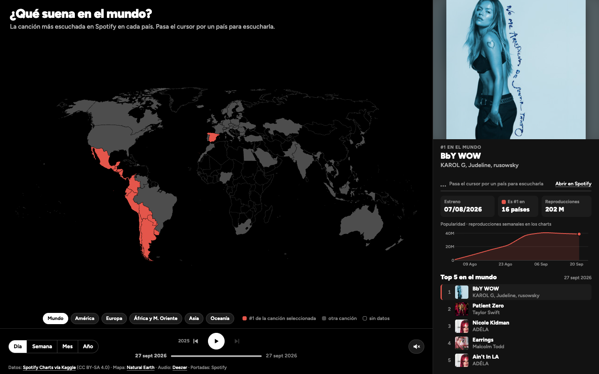
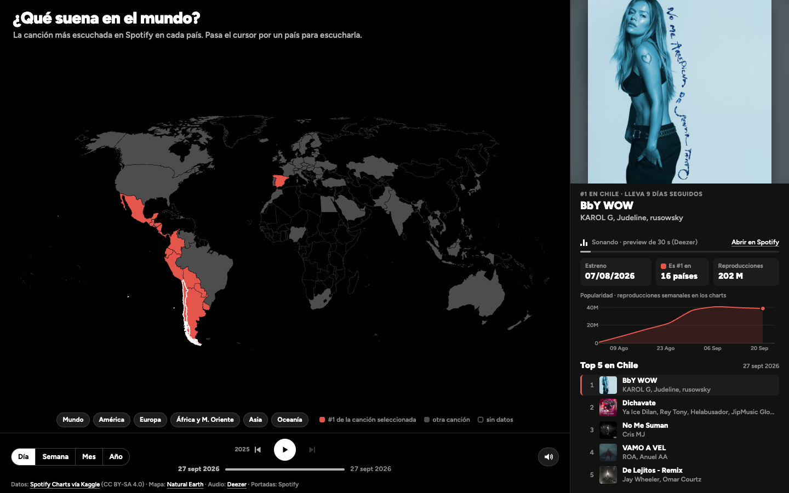
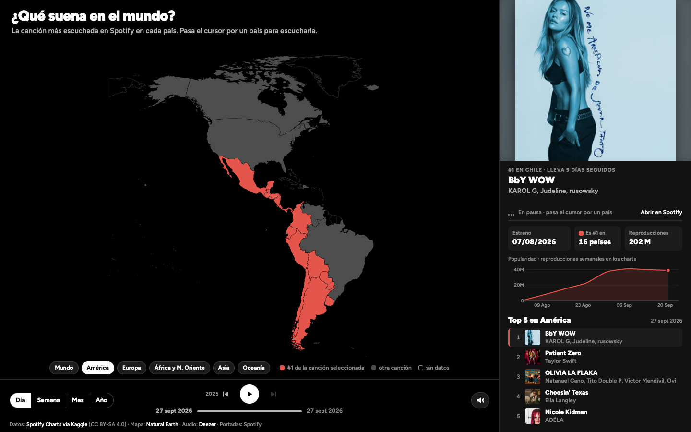
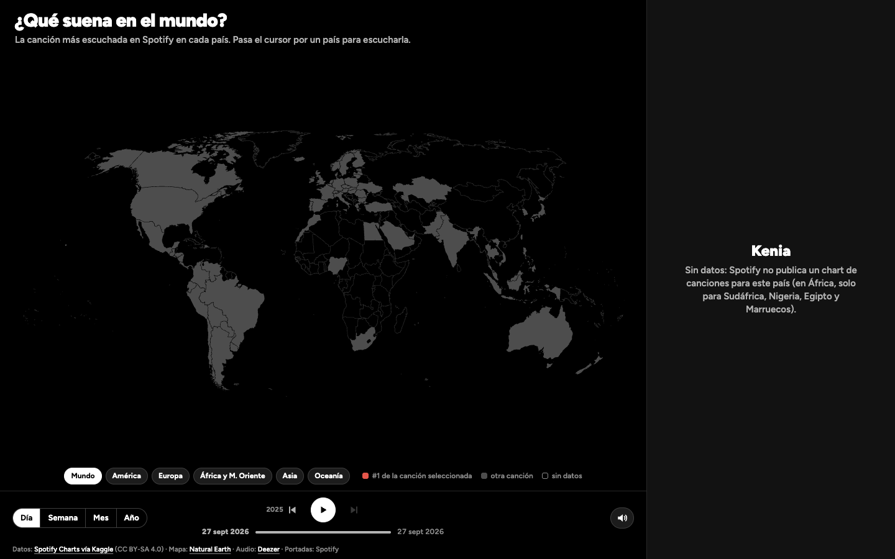

# V1 — La idea completa

> Registro de versión según la pauta E1 (sección 5).

## Identificación

| Campo | Valor |
|---|---|
| Versión | V1 |
| Fecha | 2 de octubre de 2026 |
| Tag / commit | [`v1`](https://github.com/IgnOsorioo/Proyecto-InfoVis/releases/tag/v1) → commit `ead22c5` |
| Ver en línea | https://ignosorioo.github.io/Proyecto-InfoVis/v1/ |

## Evidencia visual y sonora

| | |
|---|---|
|  |  |
| Vista general: el #1 del mundo y en coral los países donde también es #1. | Cursor sobre Chile: suena su #1 y el panel muestra portada, estadísticas, popularidad y top 5. |
|  |  |
| Botón de región: encuadra el continente completo. | País sin chart de Spotify: el panel muestra solo el mensaje. |

Versión móvil: [evidencia/05-movil.png](evidencia/05-movil.png).

**Video con audio:** https://www.youtube.com/watch?v=byQVqgL1buQ

## Qué cambió (en V1: las decisiones iniciales) — máx. 8 líneas

1. Datos: Top 200 diario de Spotify, 70 países + global, enero 2017 a septiembre 2026. Se trabaja por país, porque no hay histórico por ciudad.
2. Forma visual: mapa mundial 2D (Natural Earth). En coral, los países donde la canción seleccionada es #1; en gris, los que tienen otro #1; solo contorno, los sin datos.
3. Interacción: al pasar el cursor por un país, su #1 pasa a ser la canción seleccionada. Hay botones de región, línea de tiempo con saltos de año y granularidad día/semana/mes/año.
4. Detalle: panel lateral con portada, estreno, en cuántos países es #1, reproducciones, popularidad semanal y top 5 del país, continente o mundo.
5. Sonido: suena el preview de 30 s (Deezer) del #1 del país bajo el cursor.
6. Estilo: fondo negro, un solo color de acento (coral) y tipografía Figtree.

## Por qué — el rationale (máx. 12 líneas)

- **Por qué un mapa.** La pregunta es dónde se escucha qué, y el mapa muestra cada país junto a sus vecinos. Así se ven los bloques regionales:
  - un hit urbano que llega a #1 global pero cuyo núcleo está en Latinoamérica enciende un bloque contiguo;
  - los hits europeos se contagian a los vecinos.

  Una lista de nombres o banderas pierde esa vecindad. Además, cualquier persona sabe leer un mapa sin formación en visualización.
- **Mantra de Shneiderman:** el mapa 2D muestra los 70 países a la vez (*overview*); regiones, granularidad y línea de tiempo acercan y filtran; el cursor abre el detalle en el panel.
- **Atributo preatentivo:** un único acento (coral) sobre grises neutros hace que «salten» los países donde manda la canción seleccionada.
- **Relleno frente a contorno:** separa «otra canción» de «sin datos». Cuando ambos eran grises, en una revisión interna leímos que India no tenía datos, y sí tenía.
- **El dato se escucha:** al pasar a un país con el mismo #1, el audio no se corta, y eso agrupa a los países que comparten canción.

## Qué se descartó (máx. 5 líneas)

- **Scatter «¿explotan o viajan?» con sonido sintético (Tone.js):** con x, y, color y tamaño a la vez costaba leerlo y explorarlo. Buscamos un público sin formación técnica, de un niño a un adulto mayor.
- **Globo 3D:** Felipe Cortés desarrolló en local una variante en globo (luego el commit `41c7dc5`). Oculta medio mundo y rompe la vista general, así que se volvió al 2D.
- **Tres colores para «las más compartidas»** (commit `1aa00f8`): necesitaban una leyenda propia que competía con el panel.
- **La evolución de formatos desde los 70–80** (vinilo, casete, CD, streaming): casi todos los datos eran privados y solo EE. UU. tenía series completas (pregunta llevada a la R1).
- **Datos por ciudad:** no hay histórico público, y descargarlos con una cuenta de Spotify infringe sus condiciones de uso.
