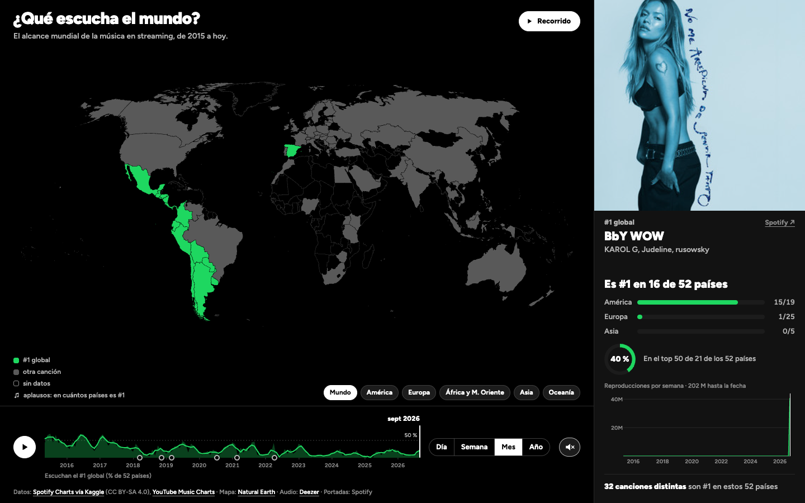
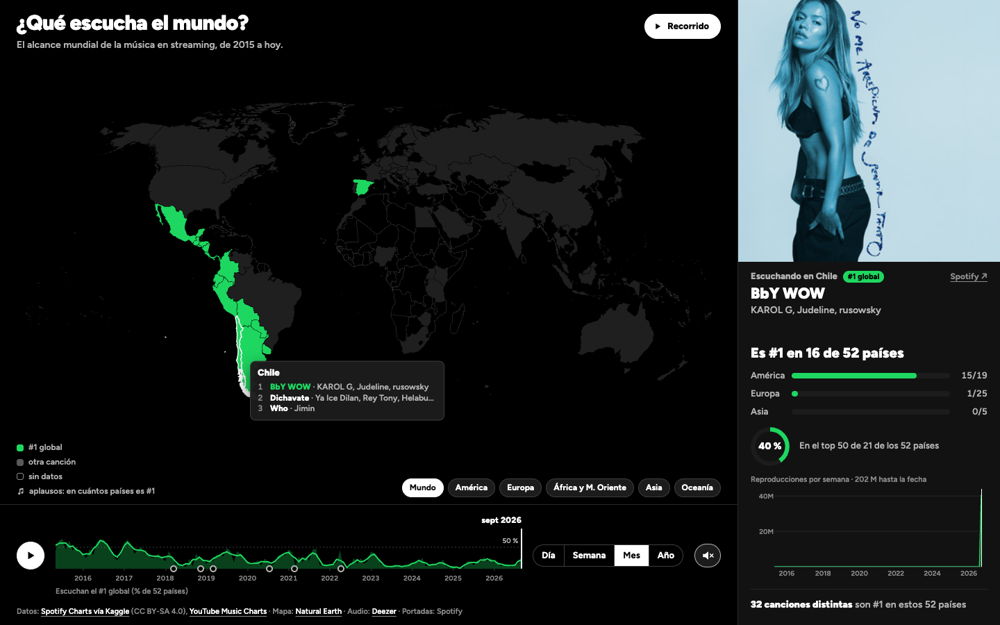
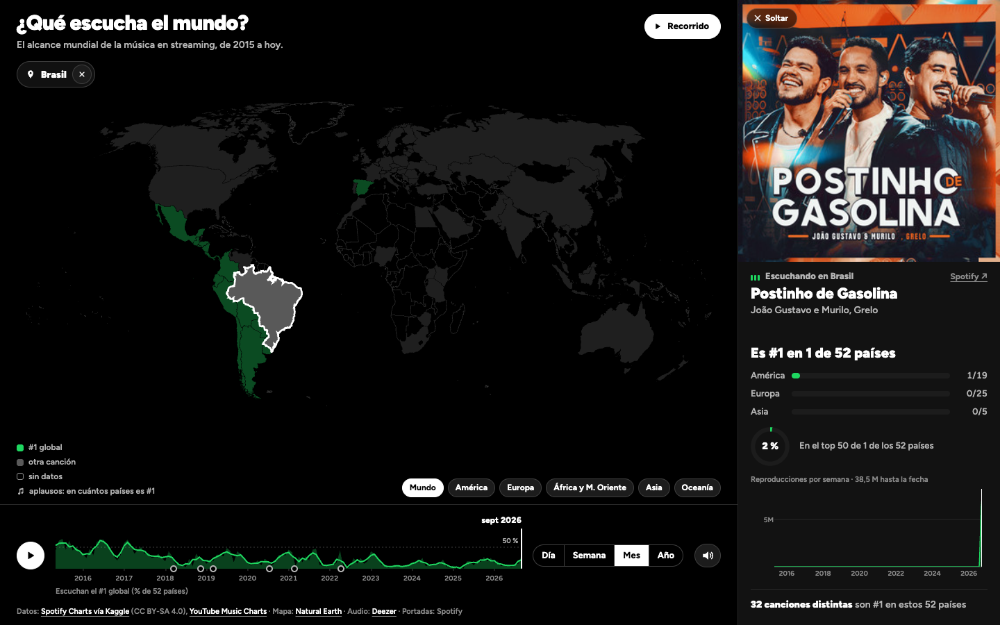
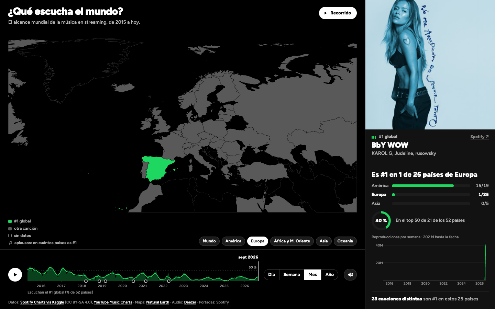
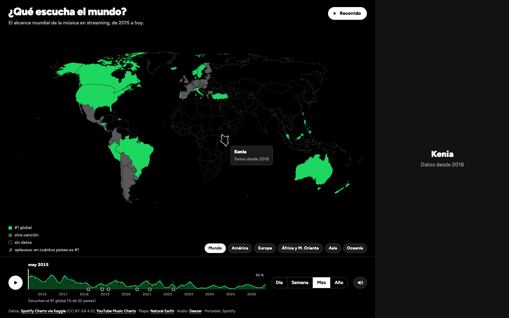
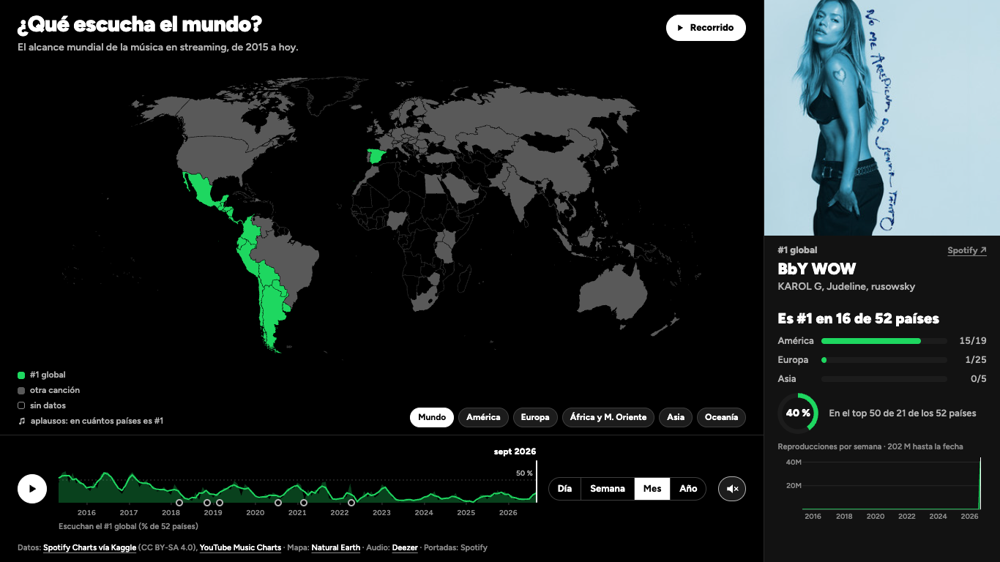

# V3 — Segunda iteración de diseño

> Registro de versión según la pauta E1 (sección 5). Responde a la [R2](../readmes/R2-revision-entre-pares.md) (revisión entre pares, 8 de octubre). **Versión cerrada.**

## Identificación

| Campo | Valor |
|---|---|
| Versión | V3 |
| Fecha | 16 de octubre de 2026 |
| Tag / commit | `v3` → commit `2b2223b` |
| Ver en línea | https://ignosorioo.github.io/Proyecto-InfoVis/v3/ |

## Evidencia visual y sonora

| | |
|---|---|
|  |  |
| Vista general: en verde, los países cuyo #1 es el #1 global. Abajo, el eje con el % de los 52 países que lo escucha. | Cursor sobre Chile: el recuadro con su top 3 y el panel con su #1. |
|  |  |
| Click en Brasil: se fija el país y suena su #1 mientras avanza el tiempo. | Botón «Europa»: acerca el mapa, y en la V3 también cambia el conteo del panel (ver la R3). |
|  |  |
| Kenia en 2015: sin datos, con estática de radio al pasar el cursor. | A 1366×768, el título de dos líneas tapa a los artistas (se corrige en la V4). |

**Video con audio: [COMPLETAR].** 30–60 s en https://ignosorioo.github.io/Proyecto-InfoVis/v3/:
1. dejar correr el tiempo unos segundos con el sonido activado (aplausos según en cuántos países es #1);
2. pasar el cursor por Chile y luego por Kenia (estática);
3. hacer click en Brasil.

## Qué cambió respecto a V2 (máx. 8 líneas)

1. **Título y pregunta nuevos, «¿Qué escucha el mundo?».** Verde: el #1 del país es el #1 global. Gris: otra canción. Contorno: sin datos.
2. **Datos de mayo de 2015 a hoy**, sobre una **muestra fija de 52 países**. Fuentes: Spotify semanal 2015–2016, Spotify diario desde 2017, YouTube Music y, para China, QQ Music.
3. **Eje de tiempo con datos:** el área es el % de los 52 países que escucha el #1 global. Tiene marcas de cuándo llega o se va Spotify.
4. **Sonido:** aplaude una persona por cada país donde la canción que suena es #1. Sobre la mitad se suma el murmullo de un estadio. En los países sin datos suena estática de radio.
5. **Panel único:** «Es #1 en N de 52», barras por continente, anillo del top 50 y reproducciones por semana. Al pasar el cursor aparece un recuadro con el top 3.
6. **Click fija un país** y la historia corre sola al entrar. Salen el buscador y el modo «seguir una canción».

## Por qué cambió — el rationale (máx. 12 líneas)

- **R2, el play se leía como la canción.** La barra fina tenía la forma de la barra de progreso de un reproductor. Un eje con datos dice qué es: el tiempo del dato, no el de la canción.
- **El título y la pregunta.** «El #1 de cada país se volvió más local» era sobrio y no transmitía la intención del proyecto: mostrar qué escucha el mundo y, en detalle, cada país.
- **R2, verde de Spotify.** La V2 usaba tres categorías con escala divergente. La pregunta pasó a ser binaria («¿igual al mundo o no?»): dos categorías, con un solo acento sobre grises, se leen de forma preatentiva.
- **R2, aplausos para el alcance.** El número de personas que aplauden codifica en cuántos países es #1 la canción (ritmo y densidad, y timbre con el murmullo), no solo el volumen. La canción no se altera (R1).
- **R2, sin datos también es un dato.** Se mantienen los países sin datos y se explica el vacío: estática de radio, hitos de Spotify y un destello cuando llegan datos (heurística «falta contexto»).
- **Datos, muestra fija.** Con un total de países que crece, el % cambiaría porque se suman países y no porque cambien los gustos. Los 52 países tienen #1 todos los días desde el 1-may-2015 (antes falta el chart global).
- **Datos, un día no es una serie.** La foto de Apple Music era la única fuente de 92 países y no tenía historia: esos países se marcan como sin datos.
- **Menos es más.** El buscador y «seguir una canción» desviaban del mensaje mundial.

## Qué se descartó (máx. 5 líneas)

- **Una voz por continente**, del unísono al acorde disperso (commit `c56e198`): había que explicarla. Los aplausos son una metáfora directa de éxito.
- **Contar sobre los 196 países o empezar en 2018:** lo primero mezcla la llegada de países con el gusto. Lo segundo pierde 2015–2017, cuando el fenómeno era más fuerte.
- **Formatos y ventas desde los 80** (la R1 pidió más datos): solo EE. UU. y Japón tienen series de unidades vendidas.
- **El buscador de 250 mil canciones de la V2:** sirve para explorar, pero no para el mensaje.

## Notas de método

- **Muestra fija de 52 países:** toda la tendencia (titular, barras, eje de tiempo, diversidad y aplausos) se cuenta sobre los mismos 52 países: los que tienen #1 en todos los días entre el 1 de mayo de 2015 y el 27 de septiembre de 2026 (`datos/v3/muestra.js`, de `scripts/11_base_fija_v3.py`). Así una cifra no cambia porque se sumen países con el tiempo, y no se cuenta como «no escucha» a un país del que no hay datos. Son 19 de América, 25 de Europa, 5 de Asia, 2 de Oceanía y Turquía. Las barras muestran solo los continentes con al menos 3 países en la muestra. Los países con datos que empiezan después (Rusia, China, Kenia, India, Japón…) se pintan en el mapa, pero no entran en la cuenta. Con la muestra, el % del eje es el mismo del titular: 2015, 51 % → 2026, 13 % (promedios anuales).
- **Alcance mundial de una canción:** en cuántos de los 52 países está en su top 50, semana a semana (`scripts/13_alcance_v3.py`). Usa los charts diarios de Spotify desde 2017 (mejor puesto de la semana) y los semanales de 2015–2016. Una canción se reconoce por título y primer artista, porque un mismo hit tiene varios IDs. No depende del tamaño del mercado y tiene la misma escala (0 a 52) para toda canción y fecha. Se ve en el anillo de cobertura del panel, bajo las barras por continente.
- **Popularidad de cada canción:** el gráfico del panel muestra sus reproducciones por semana desde que entra a los charts hasta el último día de los datos (el mismo final para toda canción). Lo anterior a la fecha de la visualización va en verde y lo posterior en gris, con una franja en la fecha.
- **Sonido:** encima de la canción, que nunca se altera, aplauden tantas personas como países donde esa canción es #1 en la fecha (de 0 a 52; el país que se mira cuenta aunque no esté en la muestra). Sobre la mitad se suma el murmullo de un estadio. Reemplaza al tono por continente. En los países sin datos suena estática de radio («sin señal») mientras el cursor esté encima.
- **Panel único:** la misma vista para cualquier canción (el #1 global o el de un país): dónde es #1 (titular y barras por continente), en cuántos países está en el top 50 (anillo) y sus reproducciones hasta hoy. Sin cursor sobre el mapa muestra el #1 global contado en la pestaña elegida (el mundo o un continente). Con el cursor sobre un país muestra el #1 de ese país, y al sacarlo vuelve solo. Un click fija el país hasta soltarlo.
- **El vacío como parte del relato:** las marcas del eje y las paradas del recorrido explican por qué hay países sin datos: cuándo llega Spotify (Sudáfrica, marzo de 2018; Medio Oriente y el norte de África, noviembre de 2018; India, febrero de 2019; Rusia, julio de 2020; 85 países más, gran parte de África, febrero de 2021) y cuándo se va (Rusia, 11 de abril de 2022). Además, el mapa destella cuando un país empieza a tener datos.
- **China (QQ Music):** su chart de canciones más escuchadas (热歌榜), semanal de 2018 a junio de 2022 y diario desde el 13 de julio de 2022 (`scripts/12_descargar_qq.py`, endpoint web sin cuenta). Entre ambos hay un hueco de 16 días. QQ no publica reproducciones, así que en mes y año gana la canción con más puntos por puesto. China no entra en la muestra, porque sus datos empiezan en 2018.
- **Diversidad de líderes** (PR #1, jtomaslarrain): «N canciones distintas son #1 en estos 52 países», sobre la muestra fija. Las canciones se comparan por su índice en el catálogo, como hace el mapa con el #1 global.
- **Un solo día de datos = sin datos:** la foto de Apple Music (el chart del 14 de octubre de 2026, sin historia) era la única fuente de 92 países. Se quitó, y esos países aparecen sin datos.
- **Una sola métrica de reproducciones:** las vistas de YouTube Music también se llaman reproducciones.
- **Reproducción automática:** al abrir la página, la historia corre sola por meses, de mayo de 2015 a hoy (unos 4 minutos y medio). Cada mes dura 1 segundo y, cuando cambia la canción que suena, ese mes dura al menos 2,6 segundos para alcanzar a escucharla (en meses, el #1 global cambia 78 veces en 137 meses). El sonido empieza con el primer click o tecla, porque los navegadores no dejan sonar nada antes. Con «reducir movimiento» activado en el sistema no arranca sola.
- **Inicio:** entre el 23 de marzo y el 23 de abril de 2015 falta el chart global de Spotify. Por eso la V3 parte el 1 de mayo de 2015 y no hay ningún instante sin datos.
- **Orden de los scripts de datos:** `08` → `09` → `10` → `11` → `13`, con `uv run --with duckdb` y la descarga de QQ Music hecha antes (`12`). Dos corridas seguidas dan los mismos archivos.
