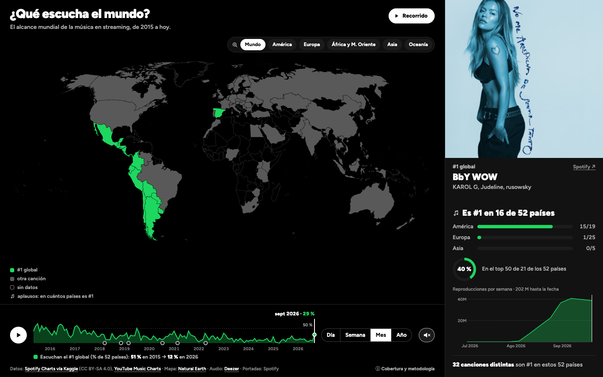
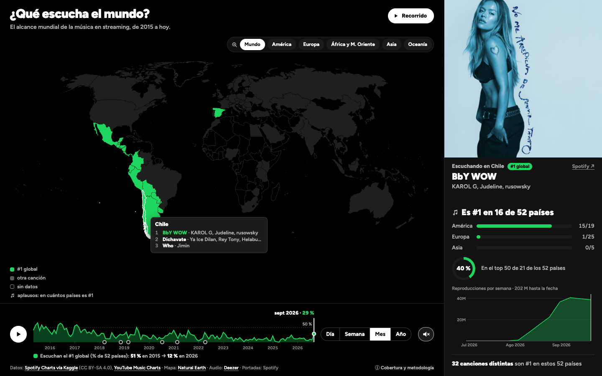
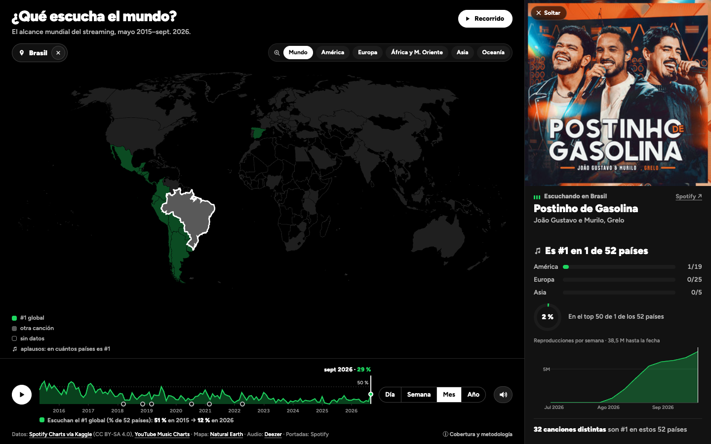
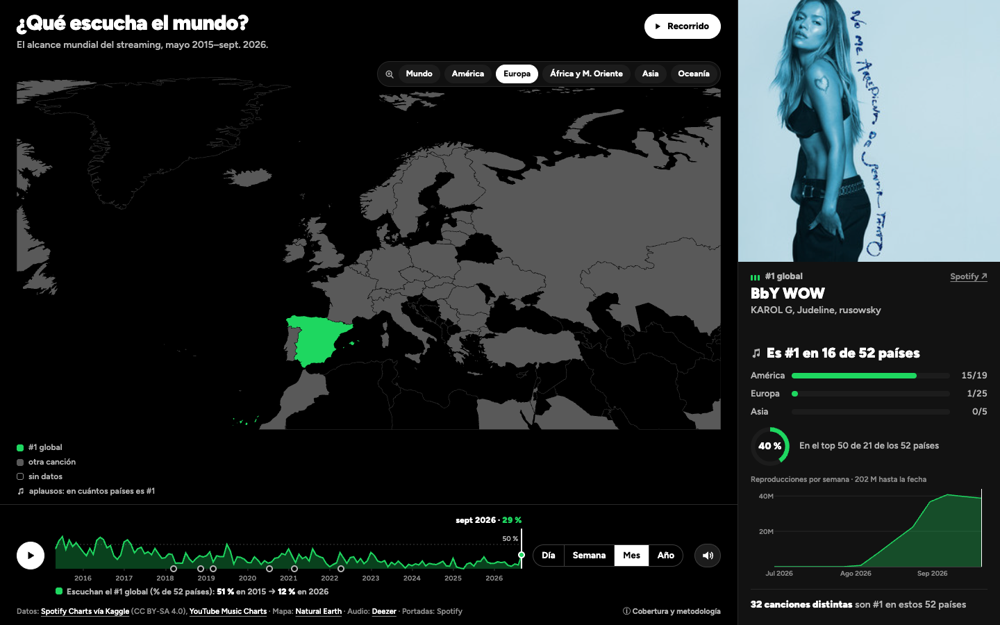
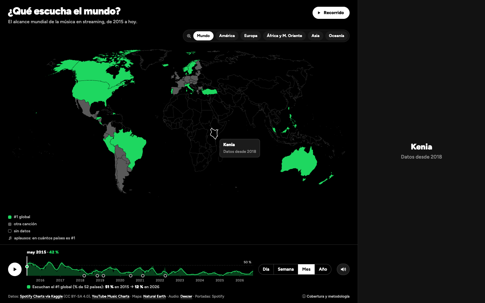
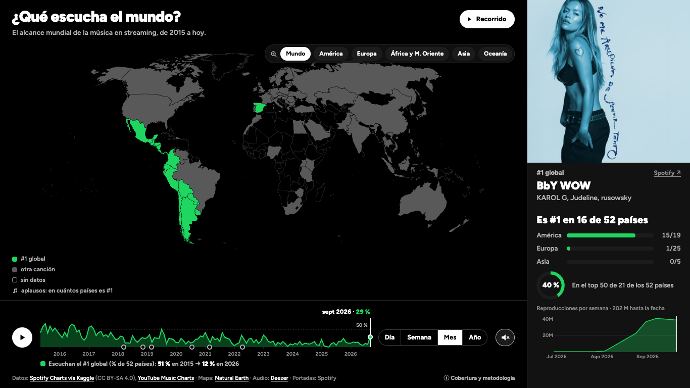

# V4 — La versión final

> Registro de versión según la pauta E1 (sección 5). Responde a la [R3](../readmes/R3-equipo-docente.md) (equipo docente) y a la auditoría del grupo frente a la pauta. Ajusta la comunicación sin agregar datos ni funciones.

## Identificación

| Campo | Valor |
|---|---|
| Versión | V4 |
| Fecha | 22 de octubre de 2026 |
| Tag / commit | `v4` → [COMPLETAR al cerrar] |
| Ver en línea | https://ignosorioo.github.io/Proyecto-InfoVis/v4/ |

## Evidencia visual y sonora

Son los mismos estados que en la [V3](../v3/README.md), para compararlos lado a lado.

| | |
|---|---|
|  |  |
| La fecha lleva su cifra, con un punto sobre la línea, y el título del eje dice el mensaje. El control para acercar va sobre el mapa. | Cursor sobre Chile: el recuadro con su top 3 y el panel con su #1. |
|  |  |
| Click en Brasil: se fija el país. Las reproducciones se encuadran en su paso por los charts (jul.–sept. 2026). | «Europa» solo acerca el mapa: el panel sigue contando los 52 países. |
|  |  |
| Kenia en 2015: sin datos. | A 1366×768, el título va en una línea y los artistas se ven. |

**Verificación técnica:** sin errores y con sonido en Chrome, WebKit (Safari) y Firefox, y recorrido completo (57 s) sin errores. La prueba encontró que Firefox rechazaba el audio de desbloqueo del primer click (un WAV sin muestras), y se corrigió.

**Video con audio: [COMPLETAR].** 30–60 s en https://ignosorioo.github.io/Proyecto-InfoVis/v4/:
1. dejar correr el tiempo con el sonido activado, para que se vea cambiar la cifra del eje y se oigan los aplausos;
2. arrastrar el eje hasta 2026;
3. hacer click en «Europa» y volver a «Mundo»;
4. pasar el cursor por Chile y por Kenia.

## Qué cambió respecto a V3 (máx. 8 líneas)

1. **Los botones de región solo acercan el mapa:** van sobre él, con una lupa, y el zoom manual no se aleja más allá del mundo.
2. **La línea de tiempo se lee:** la cifra va junto a la fecha, con un punto sobre la línea. Mide lo mismo con día, semana, mes o año (el promedio de los días).
3. **El mensaje está en la vista:** el título del eje y el cierre del recorrido dicen «51 % en 2015 → 12 % en 2026».
4. **Las reproducciones se encuadran** en el paso de cada canción por los charts.
5. **El panel no se tapa a 1366×768**, y los textos del recorrido coinciden con lo que codifica el sonido.
6. **El titular del panel lleva el ícono de los aplausos**, porque «Es #1 en N de 52 países» es justo lo que cuentan.
7. **Ficha «Cobertura y metodología»** (PR #2, José Tomás Larraín), a pedido, debajo de la vista.

## Por qué cambió — el rationale (máx. 12 líneas)

- **R3, las regiones parecían filtros, y en parte lo eran:** el panel pasaba a «N de 19 países de América» mientras el mapa y el eje seguían contando el mundo. Los ayudantes sugirieron eliminarlas, pero acercarse con el trackpad es incómodo y un zoom extremo pierde el contenido o el panorama. Por eso solo acercan, van sobre el mapa por proximidad (es un control de vista), con la lupa como convención del zoom, y el zoom manual no se aleja más allá del mundo.
- **R3 y thinking aloud, el eje no se entendía.** Raúl supuso que las líneas «deberían ser más o menos las mismas» en cada granularidad, y no lo eran: cada una comparaba el #1 del período (2025: 0 % en «Año», 25 % en diciembre). Ahora todas promedian los mismos días. La cifra junto a la fecha (rotulado directo) y el punto sobre la línea evitan leer contra un eje sin marcas. La muestra verde conecta el área con los países verdes del mapa (similitud).
- **Auditoría, vista general:** el título pregunta y la respuesta tardaba 11 años en verse. Ahora la dicen el eje y el cierre del recorrido.
- **Thinking aloud, reproducciones, zoom y aplausos:** «una canción de hace un mes queda en el extremo derecho y no aporta nada». Alejado más allá del mundo, el mapa daba «saltos abruptos». Y Raúl entendió los aplausos como popularidad, pero no si contaban países o reproducciones: el mismo ícono en la leyenda y en el titular une el sonido con su cifra (similitud).
- **§11 y heurísticas:** un panel que se tapa a sí mismo rompe el orden. Si la leyenda y el recorrido explican distinto los aplausos, el sonido no se entiende. El contexto (muestra, fuentes, fechas) queda a un click (*details on demand*).

## Qué se descartó (máx. 5 líneas)

- **Regiones como filtro real:** repetiría las barras por continente del panel. El mensaje es mundial.
- **Reducir la portada:** ver el disco mientras suena es la identidad del concepto desde la V1. La carátula se reconoce antes que el título, y el diseño imita a propósito un reproductor donde la carátula manda.
- **Mostrar los 5 continentes en el panel**, que Raúl echó de menos: Oceanía tiene 2 países en la muestra y África y Medio Oriente 1. Casi siempre marcarían 0 y no ayudarían a ver de dónde viene un hit. La ficha explica el mínimo de 3.
- **Cambiar la activación del sonido:** el navegador exige un click o una tecla, así que no hay forma de que suene al entrar. El botón de sonido ya pulsa mientras está apagado.
- **Los avisos de ámbito del PR #2 y la media móvil del eje de la V3:** sin ámbitos distintos, los avisos sobran. La media móvil separaba el punto de la línea.

## Balance del recorrido

**Qué mejoró desde la V1**
- **Mensaje.** La V1 mostraba dónde era #1 una canción. La V4 responde una pregunta con una cifra que se ve en el mapa (verde), se sigue en el eje (de 51 % a 12 %) y se oye.
- **Sonido.** La V1 solo tenía la canción (R1: «sonificación pobre»). Ahora la canción va intacta, encima van los aplausos que codifican el alcance, y la estática marca dónde no hay datos.
- **Interacción.** Antes un modal bloqueaba la entrada. Ahora hay vista general inmediata, hover con intención, click para fijar un país y un control para acercar que no se confunde con un filtro.
- **Datos.** De 70 países desde 2017 a una muestra fija de 52 desde 2015, comparable en todo el período.

**Qué decidimos no cambiar, y por qué**
- **La canción nunca se altera** (R1): es el dato. La codificación va en una capa aparte.
- **Mapa 2D:** el globo ocultaba medio mundo y rompía la vista general.
- **La muestra fija de 52 países**, aunque deja fuera a Rusia, India o China de la cifra: sin ella, la cifra mediría la llegada de Spotify y no el gusto.
- **La portada grande:** es la identidad del proyecto, ayuda a reconocer la canción y es parte de la estética de reproductor.

## Aporte individual: contexto y cobertura de los indicadores (PR #2, José Tomás Larraín)

> **Al integrarlo (merge `43e30b9`)**, el PR partía de la V3, así que se adaptó a la V4:
> - las regiones ya no cambian el ámbito, de modo que la ficha dice que todas las cifras cuentan los 52 países;
> - se quitaron el aviso junto al botón y el seguimiento del «titular pendiente»;
> - el script de validación acepta Chrome en macOS (`NAVEGADOR`) y ya no compara la posición de `.acercar`, que se movió a propósito tras la R3;
> - las capturas de `evidencia/contexto-layout/` se regeneraron con la V4 integrada.
>
> El texto original del aporte sigue abajo.

- **Problema:** según la observación de R3 comunicada por el integrante, no era suficientemente claro qué países y fuentes usan los indicadores ni cuándo difieren de la región enfocada. No se atribuye una cita literal ni una prueba con usuarios.
- **Decisión:** el control «ⓘ Cobertura y metodología» comparte la fila de créditos sin añadir altura a la visualización. Abre una sección debajo de la vista principal, sin modal ni superposición, y permite volver con botón o Escape. Los ámbitos detallados del mapa, titular, diversidad y alcance se muestran a pedido; solo queda un aviso breve cuando hay sustitución regional o un titular pendiente. Se explican la muestra fija y las diferencias de fuentes e identidad de canción.
- **Fundamento:** integridad de datos, contexto y consistencia entre etiquetas y cifras; explicación a pedido para reducir la carga cognitiva.
- **Base:** copia de `v3/index.html`, `v3/css/` y `v3/js/`, conservando las rutas a datos compartidos. No se modifica V3 ni se cambian los cálculos, el estado global, el mapa o el audio.
- **Archivos del aporte:** nuevos `js/contexto.js` y `css/contexto.css`; integración en `index.html`, `js/main.js` y una notificación al finalizar el dibujo en `js/panel.js`. Este README conserva los campos grupales pendientes.
- **Limitaciones:** el panel puede conservar un titular anterior mientras se actualiza; se informa ese estado sin cambiar su comportamiento. La muestra no es representativa del planeta; identidad y resolución de las métricas difieren. No se corrigen otros problemas heredados de V3.
- **Validación:** copia inicial de los 12 archivos verificada byte por byte contra V3; sintaxis y rutas locales correctas. En la primera integración pasaron 24 combinaciones de granularidad/región con DOM simulado. Tras el ajuste de diseño, Edge headless compara V3/V4 en 1920×1080, 1366×768 y 1280×720: estado inicial, África y ficha abierta; comprueba que no cambien posición y tamaño de mapa, eje, regiones y panel, y prueba Enter, Escape y retorno de foco. Script sin dependencias: `node v4/pruebas/validar-layout.cjs`, desde la raíz; capturas en `v4/evidencia/contexto-layout/`. Se usa movimiento reducido para comparar estados estables. No se valida aquí la calidad sonora, el recorrido completo ni el diseño móvil. No hay resultados de usuarios atribuidos a esta versión.
